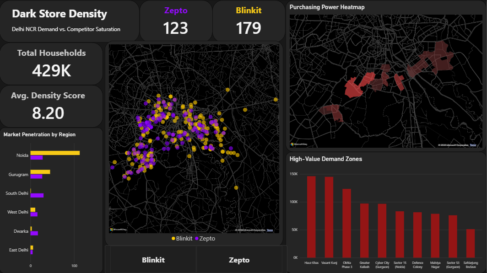

# Quick Commerce Spatial Intelligence: Delhi NCR 

## Project Overview
The Quick Commerce (Q-Commerce) sector relies entirely on hyper-local fulfillment centers known as "dark stores." To achieve 10-minute delivery times, companies must strategically place these stores in high-density, high-purchasing-power neighborhoods. 

This project is an end-to-end spatial analytics pipeline that maps the competitive footprint of major Q-Commerce players (**Blinkit** and **Zepto**) across the Delhi National Capital Region (NCR). By overlaying competitor supply (store locations) with demographic demand (average monthly rent and household density), this intelligence dashboard identifies market saturation and highlights lucrative "white spaces" for strategic expansion.

##  Dashboard & Visualizations
The dashboard is designed with a premium, dark-mode "bento-box" UI to provide an executive-level view of the market. It features the following key analytics:

*   **Executive KPI Strip:** High-level metrics tracking the total active dark stores for Blinkit and Zepto, alongside the total target households and average density score of the monitored regions.
*   **Competitor Footprint (Bubble Map):** A dark-themed geospatial plot using exact latitude and longitude coordinates to visualize the real-world density and clustering of competitor dark stores.
*   **Purchasing Power Heatmap (Filled Map):** A demographic heatmap utilizing color gradients to highlight neighborhoods based on average monthly rent, instantly revealing high-value target zones.
*   **Market Penetration by Region (Clustered Bar Chart):** A granular breakdown comparing Blinkit and Zepto's store counts across specific micro-markets (e.g., Gurugram, Noida, South Delhi) to identify regional dominance.
*   **High-Value Demand Zones (Clustered Column Chart):** A dynamic ranking of the Top 10 premium neighborhoods by rental purchasing power, directly linking demographic wealth to potential order volume.
*   **Interactive Slicers:** Responsive tile buttons allowing users to filter the entire spatial analysis by specific brands.

##  Technical Stack
*   **Data Extraction:** Python, Playwright, Selenium (Multi-threaded web scraping and API extraction)
*   **Data Storage & Modeling:** MySQL
*   **Business Intelligence:** Power BI (Data modeling, DAX, Spatial mapping, UI/UX design)
*   **Design Aesthetic:** Minimalist dark-mode (`#121212` / `#252525`) with high-contrast neon categorical accents.

##  How to Run Locally
1. Clone this repository: `git clone https://github.com/yourusername/q-commerce-spatial-analysis.git`
2. Ensure you have [Power BI Desktop](https://powerbi.microsoft.com/desktop/) installed.
3. Navigate to the `dashboard/` folder.
4. Open `q_commerce_dashboard.pbix` to view and interact with the data model.